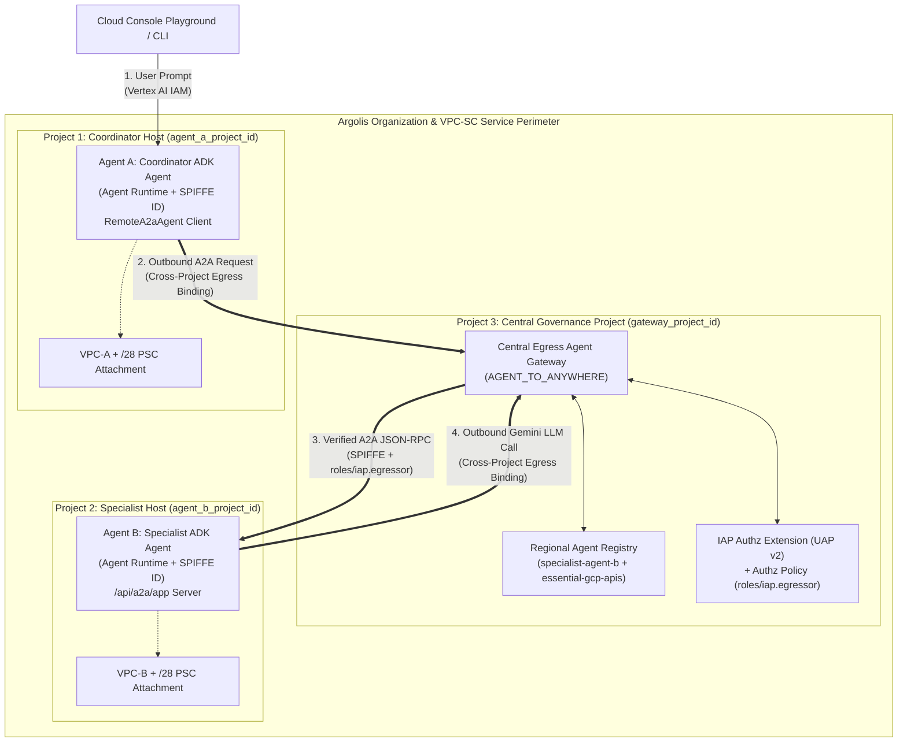

# Phased Implementation Plan: 3-Project Enterprise A2A Demo with Agent Gateway & Terraform (Argolis)

> **Architecture Decision Record:** See [docs/architecture-and-security-rationale.md](../../docs/architecture-and-security-rationale.md) for why we chose the simplified **Single Central Egress Gateway** architecture (without redundant per-project Ingress Gateways) and how the 4-plane security model guarantees that Agent A cannot bypass Project 3's Agent Gateway to call Agent B.

## Architectural Overview (Simplified 3-Project Argolis Topology)

We are building two minimal Google ADK agents deployed to **separate GCP projects** in Argolis that communicate over the **Agent-to-Agent (A2A)** protocol, with all outbound cross-project and LLM traffic governed by a **single Central Egress Agent Gateway in a third GCP project**, inside a **VPC Service Controls (VPC-SC)** perimeter, provisioned 100% via **Terraform**.

| Project Role | Variable Name | Key Resources Provisioned via Terraform |
| :--- | :--- | :--- |
| **Project 1: Coordinator Agent Host** | `agent_a_project_id` | • **Agent A (`coordinator-agent-a`)** on Vertex AI Agent Runtime (`AGENT_IDENTITY`)<br/>• Cross-project Egress Gateway binding (`agent_to_anywhere_config`) to Project 3's `central-egress-gw`<br/>• Custom Org Policy (`custom.allowlistedEgressAgentGatewaysForAgentEngine`) preventing unbound agent deployments<br/>• VPC, `/28` subnet, PSC Network Attachment (`agent-psc-attachment`), Artifact Registry |
| **Project 2: Specialist Agent Host** | `agent_b_project_id` | • **Agent B (`specialist-agent-b`)** on Vertex AI Agent Runtime (`AGENT_IDENTITY`), serving A2A at `/api/a2a/app`<br/>• Cross-project Egress Gateway binding (`agent_to_anywhere_config`) to Project 3's `central-egress-gw`<br/>• Resource-scoped `agentInvoker` IAM binding exclusively for Agent A's SPIFFE ID<br/>• Custom Org Policy (`custom.allowlistedEgressAgentGatewaysForAgentEngine`) preventing unbound agent deployments<br/>• VPC, `/28` subnet, PSC Network Attachment (`agent-psc-attachment`), Artifact Registry |
| **Project 3: Central Governance & Gateway Host** | `gateway_project_id` | • **Single Central Egress Agent Gateway (`AGENT_TO_ANYWHERE`)** governing outbound traffic from **both** Project 1 and Project 2<br/>• **Regional Agent Registry** cataloging `specialist-agent-b` and `essential-gcp-apis`<br/>• **IAP Authorization Extension (`V2`) & Authz Policy (`REQUEST_AUTHZ`, `failOpen: false`)**<br/>• Cross-project `ar_agw_cross_project_sa` IAM role granted to Project 1 & Project 2 Vertex AI Service Agents<br/>• `roles/iap.egressor` UAP bindings authorizing Agent A's SPIFFE ID to reach Agent B<br/>• GCS Bucket for remote Terraform state |



---

## Target Repository Structure

```text
multi_project_agent/
├── .specify/
│   └── memory/
│       ├── constitution.md              # Project architectural & coding invariants
│       └── plan.md                      # This active phased implementation plan
├── GEMINI.md                            # Agent workflow & verification rules
├── docs/
│   ├── architecture-and-security-rationale.md # ADR: Why simple 1-gateway architecture + anti-bypass proof
│   └── security-threats-and-mitigations.md    # Comprehensive 9-threat model & SPIFFE/SVID deep dive
├── pyproject.toml                       # Python 3.12, uv, google-adk[a2a,gcp], ruff, pytest
├── config/
│   ├── project_config.env.example       # Template for 3-project Argolis IDs & settings
│   └── project_config.env               # Active environment config (gitignored)
├── scripts/
│   ├── bootstrap_tf.sh                  # Startup script: APIs, Argolis org policies, TF backend, tfvars
│   └── build_and_push.sh                # Builds container images with Gateway Root CA & pushes to AR
├── infra/
│   └── terraform/
│       ├── versions.tf                  # google & google-beta providers, GCS backend
│       ├── variables.tf                 # Typed input variables for all 3 projects
│       ├── main.tf                      # Orchestrates modules across the 3 projects
│       ├── outputs.tf                   # Reasoning Engine IDs, SPIFFE IDs, Gateway URLs, Console links
│       └── modules/
│           ├── project_networking/      # VPC, /28 subnet, PSC network attachment, AI Platform SA IAM
│           ├── vpc_sc/                  # Access Level & VPC-SC Perimeter enclosing all 3 projects
│           ├── central_gateway/         # Project 3: Egress Gateway, Registry, IAP UAP, Cross-Project SA role, Custom Org Policy
│           ├── agent_runtime_host/      # Projects 1 & 2: Artifact Registry + Reasoning Engine bound to Project 3 Egress Gateway
│           └── a2a_governance/          # Agent B Registry entry in Project 3 + Agent A SPIFFE IAM bindings
├── agents/
│   ├── shared/
│   │   ├── __init__.py
│   │   ├── config.py                    # Centralized Settings (no scattered os.getenv)
│   │   └── utils.py                     # GoogleAdcBearerAuth, health response, logging helpers
│   ├── coordinator_agent/               # Agent A (Deployed to Project 1)
│   │   ├── __init__.py
│   │   ├── agent.py                     # Root ADK Agent + RemoteA2aAgent sub-agent
│   │   ├── server.py                    # create_app() FastAPI factory (A2A + Reasoning Engine routes)
│   │   └── Dockerfile                   # Trusts AGENT_GATEWAY_ROOT_CERTIFICATES from Project 3
│   └── specialist_agent/                # Agent B (Deployed to Project 2)
│       ├── __init__.py
│       ├── agent.py                     # Root ADK Agent + deterministic status tool
│       ├── server.py                    # create_app() FastAPI factory (A2A + Reasoning Engine routes)
│       └── Dockerfile                   # Trusts AGENT_GATEWAY_ROOT_CERTIFICATES from Project 3
└── tests/
    └── unit/
        ├── test_config_and_utils.py
        ├── test_specialist_agent.py
        └── test_coordinator_agent.py
```

---

## Journey Phases & Step-by-Step Plan

### Phase A: Basic Structure, SDD Setup, Config Files & Terraform Bootstrap Script

#### Goals
Establish the Spec-Driven Development (SDD) foundation, centralized configuration for the 3 GCP projects, Python project tooling (`pyproject.toml`), and an idempotent startup script (`scripts/bootstrap_tf.sh`) that prepares the 3 Argolis projects for Terraform.

#### Implementation Steps
1. **Populate SDD Memory (`.specify/memory/constitution.md` & `GEMINI.md`)**:
   * Define non-negotiable architectural rules in `.specify/memory/constitution.md`:
     * **3-Project Separation with Single Central Egress Gateway**: Project 1 (`agent_a_project_id`), Project 2 (`agent_b_project_id`), Project 3 (`gateway_project_id` hosting the sole `AGENT_TO_ANYWHERE` gateway).
     * **100% Terraform IaC**: All gateways, registries, VPCs, PSC attachments, Org Policies, Reasoning Engines, and IAM bindings are managed declaratively in `infra/terraform/`.
     * **Zero Hardcoded Config**: All project IDs, numbers, regions, and URLs come from `config/project_config.env` $\rightarrow$ `terraform.tfvars` / `agents/shared/config.py`.
     * **Strict Python Coding Standards**: Enforce `_agents/skills/python-coding-standards/SKILL.md` (`agents/shared/` reuse, `create_app()` factory, flat module-level functions, top-level imports, native Python 3.12 typing without `from __future__ import annotations`).
2. **Create Centralized Configuration Template (`config/project_config.env.example`)**:
   ```ini
   ORG_ID="123456789012"
   REGION="us-central1"
   GATEWAY_PROJECT_ID="argolis-agw-gov-proj"
   AGENT_A_PROJECT_ID="argolis-agent-a-proj"
   AGENT_B_PROJECT_ID="argolis-agent-b-proj"
   VPC_SC_POLICY_ID="987654321"
   VPC_SC_ADMIN_USER="user:admin@your-argolis-domain.com"
   GEMINI_MODEL="gemini-2.5-flash"
   ```
3. **Create Startup / Bootstrap Script (`scripts/bootstrap_tf.sh`)**:
   * Sources `config/project_config.env` and validates all required variables.
   * Resolves project numbers (`GATEWAY_PROJECT_NUMBER`, `AGENT_A_PROJECT_NUMBER`, `AGENT_B_PROJECT_NUMBER`) dynamically via `gcloud projects describe`.
   * Resets the Argolis boolean Organization Policy `constraints/iam.managed.disableAccessPolicyBindings` across all 3 projects so Terraform can bind `roles/iap.egressor` to Agent Registry resources.
   * Enables bootstrap APIs (`serviceusage.googleapis.com`, `cloudresourcemanager.googleapis.com`, `orgpolicy.googleapis.com`, `iam.googleapis.com`, `compute.googleapis.com`, `aiplatform.googleapis.com`, `networkservices.googleapis.com`, `networksecurity.googleapis.com`, `agentregistry.googleapis.com`, `iap.googleapis.com`, `artifactregistry.googleapis.com`, `cloudbuild.googleapis.com`) across all 3 projects.
   * Creates the Terraform remote state GCS bucket (`gs://${GATEWAY_PROJECT_ID}-tfstate`) with versioning enabled in Project 3.
   * Auto-generates `infra/terraform/terraform.tfvars` and `infra/terraform/backend.hcl`.
4. **Initialize Python Workspace (`pyproject.toml`)**:
   * Configure dependencies (`google-adk[a2a,agent-identity,gcp]>=1.29.0`, `google-cloud-aiplatform`, `fastapi`, `uvicorn`, `httpx`, `pydantic`, `pydantic-settings`) and dev dependencies (`ruff`, `pytest`, `pytest-asyncio`).

#### Phase A Verification Gate
* `bash -n scripts/bootstrap_tf.sh` passes with zero syntax errors.
* `uv run ruff check .` and `uv run ruff format --check .` pass.
* Commit Phase A changes to Git and request user approval to raise a PR.

---

### Phase B: Infrastructure as Code (Terraform Scripts for All 3 Projects)

#### Goals
Write clean, modular Terraform in `infra/terraform/` to provision networking, VPC-SC, the single Central Egress Agent Gateway + Agent Registry + Custom Org Policy in Project 3, Reasoning Engines in Projects 1 and 2 bound to Project 3's Egress Gateway, and cross-project SPIFFE IAM bindings.

#### Implementation Steps
1. **Root Configuration (`infra/terraform/versions.tf`, `variables.tf`, `main.tf`, `outputs.tf`)**:
   * Configure `hashicorp/google` and `hashicorp/google-beta` providers.
   * Define two-stage deployment toggle `var.deploy_agents` (default `false` during base infra + image build, `true` once container images are pushed) and `var.iap_enforcement_mode` (`"DRY_RUN"` vs. `"ENFORCED"`).
2. **Module 1 — `modules/project_networking` (Applied to Projects 1, 2, and 3)**:
   * Creates `google_compute_network` (`agent-vpc`), `google_compute_subnetwork` (`agent-psc-subnet`, `/28` CIDR `10.10.0.0/28`, `private_ip_google_access = true`), and `google_compute_network_attachment` (`agent-psc-attachment`, `connection_preference = "ACCEPT_AUTOMATIC"`).
   * Provisions `google_project_service_identity` for `aiplatform.googleapis.com` and `networkservices.googleapis.com`.
   * Grants `roles/compute.networkAdmin` to `service-${project_number}@gcp-sa-aiplatform.iam.gserviceaccount.com` so Agent Runtime can attach its tenant PSC interface.
3. **Module 2 — `modules/vpc_sc` (Org-Level Perimeter Across All 3 Projects)**:
   * Provisions `google_access_context_manager_access_level` for `var.vpc_sc_admin_user`.
   * Provisions `google_access_context_manager_service_perimeter` enclosing `projects/${gateway_project_number}`, `projects/${agent_a_project_number}`, and `projects/${agent_b_project_number}` with `vpc_accessible_services` enabled (`RESTRICTED-SERVICES`).
4. **Module 3 — `modules/central_gateway` (Project 3: `gateway_project_id` + Org Policy)**:
   * **Central Egress Gateway**: `google_network_services_agent_gateway.central_egress_gw` with `governed_access_path = "AGENT_TO_ANYWHERE"` and `registries = ["//agentregistry.googleapis.com/projects/${var.gateway_project_id}/locations/${var.region}"]`.
   * **IAP Extension & Authz Policy**:
     * `google_network_services_authz_extension.iap_ext` (`service = "iap.googleapis.com"`, `fail_open = false`, `metadata = { iapPolicyVersion = "V2", ... }`).
     * `google_network_security_authz_policy.iap_policy` (`policy_profile = "REQUEST_AUTHZ"`, `action = "CUSTOM"`).
   * **Cross-Project Binding Role**:
     * `google_project_iam_custom_role.ar_agw_cross_project_sa` in Project 3 with `networkservices.agentGateways.get` and `networkservices.operations.get`.
     * `google_project_iam_member` granting that role to `service-${agent_a_project_number}@gcp-sa-aiplatform.iam.gserviceaccount.com` and `service-${agent_b_project_number}@gcp-sa-aiplatform.iam.gserviceaccount.com`.
   * **Anti-Bypass Control-Plane Constraint (Custom Organization Policy)**:
     * `google_org_policy_custom_constraint.require_central_egress_gw` (`custom.allowlistedEgressAgentGatewaysForAgentEngine`) on `aiplatform.googleapis.com/ReasoningEngine` (`CREATE`, `UPDATE`) requiring `resource.spec.deploymentSpec.agentGatewayConfig.agentToAnywhereConfig.agentGateway` to equal Project 3's `central-egress-gw`.
     * `google_org_policy_policy` attaching the constraint to both Project 1 (`agent_a_project_id`) and Project 2 (`agent_b_project_id`).
   * **Essential GCP APIs Registration & UAP**:
     * `google_agent_registry_service.essential_gcp_apis` registering `aiplatform`, `${region}-aiplatform` (standard, `.mtls`, `.rep`), `logging`, `telemetry`, `cloudtrace`, `monitoring`, and `agentregistry` hostnames.
     * `google_iap_agent_registry_endpoint_iam_member` granting `roles/iap.egressor` on `essential-gcp-apis` to `principalSet://agents.global.org-${var.org_id}.system.id.goog/attribute.platformContainer/aiplatform/projects/${proj_num}` for both Project 1 and Project 2.
5. **Module 4 — `modules/agent_runtime_host` (Instantiated in Project 1 & Project 2)**:
   * Creates `google_artifact_registry_repository` (`agent-repo`) in each agent project.
   * Creates `google_vertex_ai_reasoning_engine` (`provider = google-beta`) with:
     * `spec.identity_type = "AGENT_IDENTITY"`
     * `spec.container_spec.image_uri` pointing to the project's Artifact Registry image
     * `spec.deployment_spec.psc_interface_config.network_attachment` pointing to the local `agent-psc-attachment`
     * `spec.deployment_spec.agent_gateway_config.agent_to_anywhere_config.agent_gateway` pointing cross-project to **Project 3's** `central-egress-gw` *(no local Ingress Gateway needed)*
6. **Module 5 — `modules/a2a_governance` (Cross-Project A2A Registration & SPIFFE IAM)**:
   * Registers Agent B's A2A endpoint (`specialist-agent-b`) in **Project 3's Agent Registry** (`google_agent_registry_service`) with both standard and `.mtls.googleapis.com` `/api/a2a/app` URLs.
   * Constructs Agent A's deterministic SPIFFE principal from `module.agent_a_host.engine_id`:
     ```hcl
     principal://agents.global.org-${var.org_id}.system.id.goog/resources/aiplatform/projects/${var.agent_a_project_number}/locations/${var.region}/reasoningEngines/${module.agent_a_host.engine_id}
     ```
   * Grants Agent A's SPIFFE principal:
     1. `roles/iap.egressor` on `specialist-agent-b` in Project 3 (`google_iap_agent_registry_endpoint_iam_member`).
     2. `roles/agentregistry.viewer` on Project 3 (`google_project_iam_member`).
     3. Least-privilege custom role `agentInvoker` (`aiplatform.reasoningEngines.query`, `aiplatform.reasoningEngines.get`) on Agent B in Project 2.

#### Phase B Verification Gate
* `terraform fmt -check -recursive infra/terraform/` passes.
* `terraform -chdir=infra/terraform init -backend=false && terraform -chdir=infra/terraform validate` passes with zero errors.
* Commit Phase B changes to Git and request user approval to raise a PR.

---

### Phase C: Basic ADK Agents (Shared Config, Specialist Agent B & Coordinator Agent A)

#### Goals
Implement two minimal, clean, production-grade ADK agents adhering strictly to `_agents/skills/python-coding-standards/SKILL.md`, with Dockerfiles configured to trust Project 3's Agent Gateway Root CA.

#### Implementation Steps
1. **Shared Configuration & Utilities (`agents/shared/config.py` & `agents/shared/utils.py`)**:
   * `agents/shared/config.py`: Define `Settings` holding `app_name`, `app_version`, `port`, `gemini_model`, `gateway_project_id`, `region`, `remote_agent_b_id` (`"agents/specialist-agent-b"`), `app_url`, and `google_genai_use_vertexai`—centralizing all environment variable reads in one file.
   * `agents/shared/utils.py`: Define flat top-level functions `build_health_response()`, `create_authenticated_httpx_client()`, and `resolve_remote_a2a_agent()` (which uses `google.adk.integrations.agent_registry.AgentRegistry` to look up Agent B by its logical identifier in Project 3's registry).
2. **Specialist Agent B (`agents/specialist_agent/` — Deployed to Project 2)**:
   * `agent.py`:
     * Define a simple deterministic tool `get_project_b_ticket_status(ticket_id: str) -> dict[str, str]` that returns a clear payload confirming execution inside Project 2 (e.g., `{"ticket_id": ticket_id, "status": "APPROVED_IN_PROJECT_B", "handler": "specialist_agent_b"}`).
     * Define `root_agent = Agent(name="specialist_agent_b", model=settings.gemini_model, description="...", instruction="...", tools=[get_project_b_ticket_status])` and `app = App(name="app", root_agent=root_agent)`.
   * `server.py`:
     * Implement `create_app() -> FastAPI` factory mounting the ADK FastAPI app, A2A routes (`/a2a/app/.well-known/agent-card.json` and `/a2a/app`), Reasoning Engine adapter routes (`/api/reasoning_engine`, `/api/stream_reasoning_engine`), and `/health`, with `app = create_app()` at the bottom.
3. **Coordinator Agent A (`agents/coordinator_agent/` — Deployed to Project 1)**:
   * `agent.py`:
     * Define `root_agent = Agent(name="coordinator_agent_a", model=settings.gemini_model, ...)` that delegates ticket status lookups to `specialist_agent_b`.
   * `server.py`: Symmetrical `create_app() -> FastAPI` factory.
4. **Agent Gateway CA-Trusting Dockerfiles (`agents/*/Dockerfile`) & Build Script (`scripts/build_and_push.sh`)**:
   * Each `Dockerfile` accepts `ARG AGENT_GATEWAY_ROOT_CERTIFICATES`, splits and installs the PEM certificates via `update-ca-certificates`, and exports `SSL_CERT_FILE`, `REQUESTS_CA_BUNDLE`, and `GRPC_DEFAULT_SSL_ROOTS_FILE_PATH`.
   * `scripts/build_and_push.sh` fetches `agentGatewayCard.rootCertificates` from `central-egress-gw` in Project 3 and runs `gcloud builds submit` to build and push both images to Project 1 and Project 2's Artifact Registries.

#### Phase C Verification Gate
* `uv run ruff check .` and `uv run ruff format --check .` pass.
* `uv run pytest tests/unit/` passes (testing tool output, `/health`, and `create_app()` routes without hitting live LLMs).
* Commit Phase C changes to Git and request user approval to raise a PR.

---

### Phase D: Cross-Project A2A Communication Through Agent Gateway & Agent Registry

#### Goals
Wire Agent A (Project 1) to authenticate using its SPIFFE Agent Identity, resolve Agent B by its logical identifier (`"agents/specialist-agent-b"`) in Project 3's Central Agent Registry, and invoke Agent B (Project 2) over A2A through the Central Egress Gateway in Project 3.

#### Implementation Steps
1. **SPIFFE-Backed `httpx.Auth` Middleware (`agents/shared/utils.py`)**:
   * Implement flat top-level class `GoogleAdcBearerAuth(httpx.Auth)` that refreshes Application Default Credentials (`google.auth.default(scopes=["https://www.googleapis.com/auth/cloud-platform"])`) and injects `Authorization: Bearer <token>` on every A2A HTTP call (including fetching `.well-known/agent-card.json` and posting JSON-RPC tasks).
2. **Identifier-Based Discovery via `AgentRegistry` (`agents/shared/utils.py` & `agents/coordinator_agent/agent.py`)**:
   * Use `google.adk.integrations.agent_registry.AgentRegistry` so Agent A resolves Agent B dynamically by its logical identifier in Project 3 (`"agents/specialist-agent-b"`), with zero hardcoded Project 2 URLs:
     ```python
     registry = AgentRegistry(
         project_id=settings.gateway_project_id,
         location=settings.region,
     )
     specialist_sub_agent = registry.get_remote_a2a_agent(
         agent_name=settings.remote_agent_b_id,  # "agents/specialist-agent-b"
         httpx_client=create_authenticated_httpx_client(),
     )
     ```
   * Attach `sub_agents=[specialist_sub_agent]` to `coordinator_agent_a`.
3. **End-to-End Terraform Orchestration Flow (`infra/terraform/main.tf`)**:
   * **Pass 1 (`deploy_agents = false`)**: Creates VPCs, PSC attachments, VPC-SC perimeter, Custom Org Policy, and `central-egress-gw` in Project 3 (`iap_enforcement_mode = "DRY_RUN"`).
   * **Image Build (`scripts/build_and_push.sh`)**: Extracts Project 3's `central-egress-gw` Root CA and builds/pushes `coordinator-agent` (to Project 1) and `specialist-agent` (to Project 2).
   * **Pass 2 (`deploy_agents = true`, `iap_enforcement_mode = "ENFORCED"`)**: Deploys both Reasoning Engines with `AGENT_IDENTITY` and cross-project Egress Gateway bindings to Project 3, injects `GATEWAY_PROJECT_ID` and `REMOTE_AGENT_B_ID="agents/specialist-agent-b"` into Agent A's env vars, registers Agent B in Project 3's Agent Registry, binds Agent A's SPIFFE principal to `roles/iap.egressor`, `roles/agentregistry.viewer`, and `agentInvoker`, and switches `central-egress-gw` to `ENFORCED`.

#### Phase D Verification Gate
* `uv run ruff check .`, `uv run ruff format --check .`, and `uv run pytest` pass.
* `terraform -chdir=infra/terraform validate` passes.
* Commit Phase D changes to Git and request user approval to raise a PR.

---

### Phase E: Testing & Verification in Google Cloud Console

#### Goals
Provide a step-by-step runbook to test and demonstrate the 3-project setup live in the **Google Cloud Console** across Project 1, Project 2, and Project 3.

#### Cloud Console Verification Steps (Documented in `docs/cloud-console-testing-guide.md`)
1. **Verify Central Agent Gateway & Agent Registry in Project 3 (`gateway_project_id`)**:
   * Open **Google Cloud Console $\rightarrow$ Select Project 3 (`gateway_project_id`)**.
   * Navigate to **Network Services $\rightarrow$ Agent Gateways**:
     * Verify `central-egress-gw` is `ACTIVE` with Governed Access Path = `Agent-to-Anywhere` and Policy Mode = `Enforced (UAP v2)`.
   * Navigate to **Agent Registry**:
     * Verify `specialist-agent-b` (pointing to Project 2's Reasoning Engine `/api/a2a/app`) and `essential-gcp-apis` are registered.
     * Inspect the IAM policy on `specialist-agent-b` to show Agent A's SPIFFE principal (`principal://agents.global.org-.../reasoningEngines/<ENGINE_A_ID>`) holding `IAP-secured Egress Accessor` (`roles/iap.egressor`).
2. **Verify Agent Identity & Cross-Project Egress Bindings in Projects 1 & 2**:
   * Switch Console to **Project 2 (`agent_b_project_id`) $\rightarrow$ Vertex AI $\rightarrow$ Agent Engine**:
     * Click `specialist-agent-b` $\rightarrow$ **Deployment details**:
       * Verify **Identity** shows `principal://agents.global.org-.../projects/<PROJ_2_NUM>/.../reasoningEngines/<ENGINE_B_ID>`.
       * Verify **Egress Gateway** is bound cross-project to `projects/<PROJ_3_ID>/locations/us-central1/agentGateways/central-egress-gw`.
   * Switch Console to **Project 1 (`agent_a_project_id`) $\rightarrow$ Vertex AI $\rightarrow$ Agent Engine**:
     * Click `coordinator-agent-a` $\rightarrow$ **Deployment details** and verify its SPIFFE Identity and cross-project Egress Gateway binding to Project 3.
3. **Interactive End-to-End A2A Test in Cloud Console Playground**:
   * In **Project 2 (`agent_b_project_id`) $\rightarrow$ Vertex AI $\rightarrow$ Agent Engine $\rightarrow$ `specialist-agent-b` $\rightarrow$ Playground**:
     * Enter: `"Check the status of ticket TKT-101"`
     * Confirm `specialist_agent_b` invokes `get_project_b_ticket_status` and returns `APPROVED_IN_PROJECT_B`.
   * In **Project 1 (`agent_a_project_id`) $\rightarrow$ Vertex AI $\rightarrow$ Agent Engine $\rightarrow$ `coordinator-agent-a` $\rightarrow$ Playground**:
     * Enter: `"Ask the specialist agent in Project B for the status of ticket TKT-101"`
     * Confirm `coordinator_agent_a` delegates over A2A to `specialist_agent_b` (routing Project 1 $\rightarrow$ Project 3 `central-egress-gw` $\rightarrow$ Project 2 `specialist-agent-b`) and displays the response from Project 2.
4. **Verify Distributed Traces & SPIFFE Audit Logs in Cloud Console**:
   * Open **Trace Explorer** in Project 1 & Project 3 to view the multi-hop OpenTelemetry trace across the gateway.
   * Open **Logs Explorer** in **Project 3 (`gateway_project_id`)** and query:
     ```text
     resource.type="networkservices.googleapis.com/AgentGateway"
     ```
     to show the live gateway allow decision for Agent A's SPIFFE ID calling `specialist-agent-b`.
   * Open **Logs Explorer** in **Project 2 (`agent_b_project_id`)** and query:
     ```text
     resource.type="aiplatform.googleapis.com/ReasoningEngine"
     ```
     to show Agent A's SPIFFE `principal://` identity authenticated as the caller.
5. **Live Negative Governance Demo in Cloud Console (Blocking Unauthorized A2A)**:
   * In **Project 3 (`gateway_project_id`)**, remove Agent A's `roles/iap.egressor` binding on `specialist-agent-b`.
   * Re-send `"Ask the specialist agent in Project B for the status of ticket TKT-101"` in Project 1's Agent Engine Playground.
   * Show in Project 3's **Logs Explorer** that `central-egress-gw` intercepts and blocks the cross-project A2A request (`HTTP 498` / IAP deny), then restore the binding.

#### Phase E Verification Gate
* `uv run ruff check .` and `uv run ruff format --check .` pass.
* Commit Phase E changes to Git and request user approval to raise a PR.
