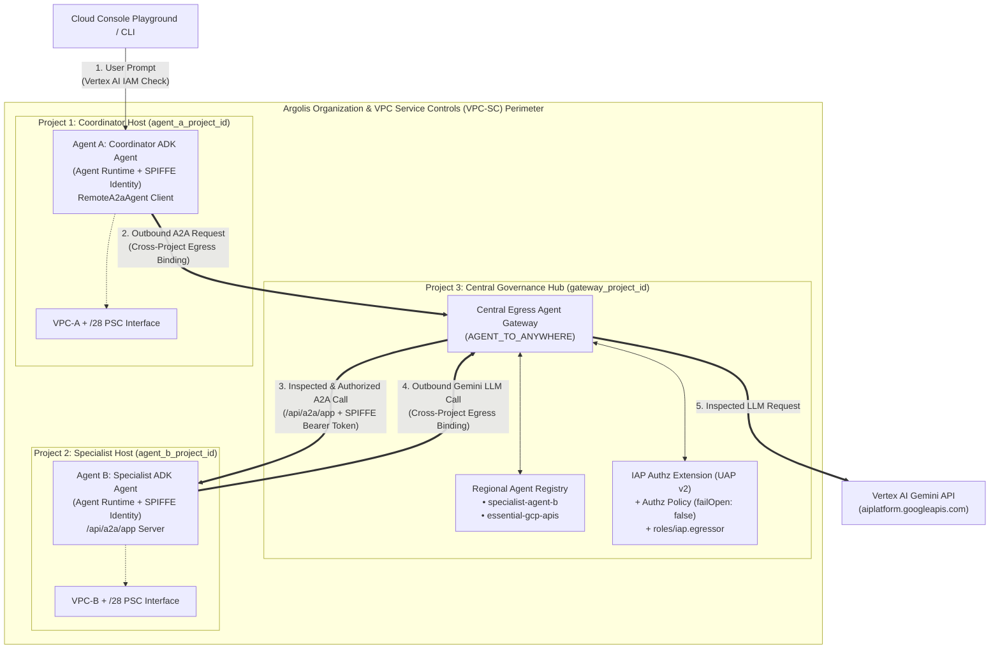
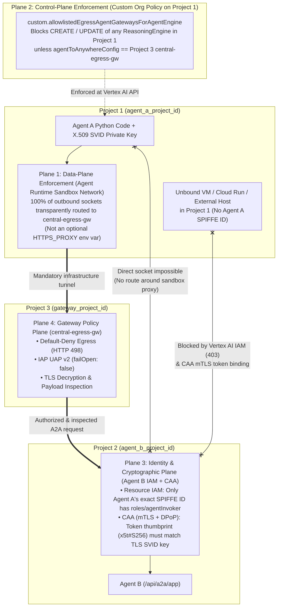

# Architecture Decision Record & Security Rationale: Simplified 3-Project A2A Governance

This document explains **why** we selected the simplified 3-project **Single Central Egress Gateway** architecture for cross-project Agent-to-Agent (A2A) communication on Vertex AI Agent Runtime, and **how** this architecture guarantees end-to-end zero-trust security—specifically ensuring that **Agent A can never bypass the central Agent Gateway in Project 3 to invoke Agent B in Project 2**.

---

## 1. The Chosen Architecture (Simplified 3-Project Topology)

Instead of provisioning separate Ingress Gateways (`CLIENT_TO_AGENT`) in every agent project plus an Egress Gateway (`AGENT_TO_ANYWHERE`) in a third project, our architecture uses **a single Central Egress Agent Gateway (`AGENT_TO_ANYWHERE`) in Project 3** governing all outbound traffic from both **Agent A (Project 1)** and **Agent B (Project 2)**.



| Project | Role | Key Resources |
| :--- | :--- | :--- |
| **Project 1 (`agent_a_project_id`)** | Coordinator Agent Host | • **Agent A (`coordinator-agent-a`)** on Vertex AI Agent Runtime (`identity_type = AGENT_IDENTITY`)<br/>• Cross-project Egress binding to Project 3's `central-egress-gw`<br/>• Custom Org Policy requiring `central-egress-gw` on ReasoningEngine `CREATE`/`UPDATE`<br/>• VPC, `/28` subnet, PSC Network Attachment, Artifact Registry |
| **Project 2 (`agent_b_project_id`)** | Specialist Agent Host | • **Agent B (`specialist-agent-b`)** on Vertex AI Agent Runtime (`identity_type = AGENT_IDENTITY`) serving A2A on `/api/a2a/app`<br/>• Cross-project Egress binding to Project 3's `central-egress-gw`<br/>• Resource-scoped `roles/agentInvoker` IAM binding granting access **only** to Agent A's SPIFFE ID<br/>• Custom Org Policy requiring `central-egress-gw` on ReasoningEngine `CREATE`/`UPDATE`<br/>• VPC, `/28` subnet, PSC Network Attachment, Artifact Registry |
| **Project 3 (`gateway_project_id`)** | Central Security & Governance Hub | • **Single Central Egress Gateway (`central-egress-gw`)** (`governed_access_path = AGENT_TO_ANYWHERE`)<br/>• **Central Agent Registry** cataloging `specialist-agent-b` and `essential-gcp-apis`<br/>• **IAP UAP v2 (`AuthzExtension` + `AuthzPolicy`)** enforcing `roles/iap.egressor` with `failOpen: false`<br/>• Cross-project custom role (`ar_agw_cross_project_sa`) granted to Project 1 & Project 2 Vertex AI Service Agents |

---

## 2. Why We Chose This Architecture (Architectural Rationale)

### 2.1 One Agent Gateway Cannot Do Both Ingress and Egress
In Google Cloud Network Services, every `AgentGateway` resource must declare a single immutable `governed_access_path` at creation time:
* **`AGENT_TO_ANYWHERE` (Egress Gateway):** Intercepts outbound traffic leaving an agent container toward external APIs, MCP servers, or other agents.
* **`CLIENT_TO_AGENT` (Ingress Gateway):** Intercepts inbound traffic arriving at an agent from external clients.

Furthermore, Google Cloud enforces asymmetric cross-project rules on these two modes:
* **`AGENT_TO_ANYWHERE` (Egress) supports cross-project binding:** Multiple agent projects (Project 1 and Project 2) can bind their Reasoning Engines' `agent_to_anywhere_config` to a single central Egress Gateway in Project 3 (`gateway_project_id`), provided Project 3 grants `networkservices.agentGateways.get` and `networkservices.operations.get` to each agent project's Vertex AI Service Agent (`service-<PROJECT_NUMBER>@gcp-sa-aiplatform.iam.gserviceaccount.com`).
* **`CLIENT_TO_AGENT` (Ingress) does NOT support cross-project binding:** An Ingress Gateway must reside in the **exact same project and region** as the Reasoning Engine it fronts.

### 2.2 Why Local Ingress Gateways Are Redundant for Cross-Project A2A on Agent Runtime
A natural question is: *"When Agent A calls Agent B, that call is egress for Agent A and ingress for Agent B—do we need an Ingress Gateway in Project 2?"*

We intentionally omitted `CLIENT_TO_AGENT` Ingress Gateways in Projects 1 and 2 for three technical reasons:

1. **Agent A's Egress *Is* the Governance Point for the A2A Hop:**
   When Agent A calls Agent B, the request originates inside Agent A's runtime container. Because Agent A's egress is bound to Project 3's `central-egress-gw`, **Project 3's Egress Gateway intercepts, decrypts, inspects, and authorizes the A2A call before it ever leaves Google's managed proxy layer toward Project 2**. Adding a second gateway on Agent B's ingress would inspect the exact same A2A packet twice.
2. **`CLIENT_TO_AGENT` on Agent Runtime Only Governs `:query` and `:streamQuery`:**
   Per Google Cloud's Agent Gateway managed deployment specification, a `CLIENT_TO_AGENT` gateway attached to an Agent Runtime `ReasoningEngine` only governs the `:query` and `:streamQuery` REST methods. However, ADK's `RemoteA2aAgent` communicates using the **A2A HTTP passthrough endpoint** (`/api/a2a/app/.well-known/agent-card.json` and `/api/a2a/app`), which uses standard Vertex AI IAM (`aiplatform.reasoningEngines.query` / `get`) rather than the `CLIENT_TO_AGENT` gateway path.
3. **Matches Google Cloud's Official Cross-Project Reference Architecture:**
   Google Cloud's official *"Cross-project governance for Runtime agents"* pattern uses a dedicated governance project hosting an `AGENT_TO_ANYWHERE` Egress Gateway, while individual developer projects host the runtime agents bound cross-project to that central egress gateway. This keeps security policy in one place (Project 3) and removes 2 redundant gateways and 2 duplicate IAP policy stacks from Terraform.

---

## 3. How Agent A Discovers and Invokes Agent B Over A2A

### 3.1 Identifier-Based Discovery via `AgentRegistry` (Zero Hardcoded URLs or JSON-RPC Boilerplate)
Rather than hardcoding Project 2's numeric Reasoning Engine URL inside Agent A or manually constructing A2A JSON-RPC payloads, the stack divides responsibilities cleanly across **ADK**, **Agent Registry**, and **Agent Gateway**:

1. **Logical Identifier Lookup (`AgentRegistry.get_remote_a2a_agent`)**:
   Using `google.adk.integrations.agent_registry.AgentRegistry` (`google-adk[a2a,agent-identity,gcp]>=1.29.0`), Agent A resolves Agent B at startup using only **Project 3's Governance Project ID** and **Agent B's logical identifier** (`"agents/specialist-agent-b"`):
   ```python
   from google.adk.integrations.agent_registry import AgentRegistry

   registry = AgentRegistry(
       project_id=settings.gateway_project_id,
       location=settings.region,
   )
   specialist_sub_agent = registry.get_remote_a2a_agent(
       agent_name=settings.remote_agent_b_id,  # "agents/specialist-agent-b"
       httpx_client=create_authenticated_httpx_client(),
   )
   ```
2. **Automated A2A Protocol (`RemoteA2aAgent` & `AgentCardBuilder`)**:
   * **Server Side (Agent B)**: `attach_a2a_routes()` automatically introspects `specialist_agent_b`, serves `GET /a2a/app/.well-known/agent-card.json`, and handles `POST /a2a/app` JSON-RPC 2.0 requests (`message/send`, `message/stream`).
   * **Client Side (Agent A)**: Attaching `sub_agents=[specialist_sub_agent]` automatically registers a sub-agent delegation tool for Gemini and serializes/deserializes the A2A JSON-RPC messages automatically.
3. **Out-of-the-Box Capabilities Provided by Agent Gateway + Agent Registry**:

| Capability | What the Platform Provides Out of the Box | Code Eliminated |
| :--- | :--- | :--- |
| **Logical ID Resolution** | `AgentRegistry.get_remote_a2a_agent("agents/specialist-agent-b")` resolves Agent B's live URL and `AgentCard` from Project 3's registry. | No hardcoded Project 2 Reasoning Engine URLs in Agent A. |
| **Transparent Network Proxy** | `central-egress-gw` transparently intercepts outbound sockets from Agent A's sandbox without requiring special gateway URLs. | No proxy routing code or URL rewriting. |
| **SPIFFE mTLS & Token Binding** | Auto-provisions/rotates 24-hour X.509 SVIDs and certificate-bound OAuth tokens (`cnf.x5t#S256`) via `google.auth.default()`. | No JSON service account keys or manual cert rotation. |
| **External Credential Injection** | Agent Registry `AuthProvider` bindings (`google_agent_registry_binding`) can inject API keys, 2LO, or 3LO OAuth for external tools/agents. | No Secret Manager or OAuth exchange boilerplate. |
| **Layer 7/8 Policy & DLP Firewall** | Evaluates IAP UAP v2 (`roles/iap.egressor`), LLM token quotas, and Model Armor (prompt injection/DLP) at the gateway edge. | No custom RBAC or DLP middleware inside FastAPI. |
| **Fleet Topology & Tracing** | Automatically renders the cross-project Topology Graph in Cloud Console and correlates OpenTelemetry traces across projects. | No custom topology or trace correlation code. |

### 3.2 End-to-End Request Lifecycle

When a user tests the system in the Google Cloud Console Playground (or via CLI):

1. **Startup — Agent A $\rightarrow$ Central Egress Gateway (Project 3) $\rightarrow$ Agent Registry (Project 3):**
   * `registry.get_remote_a2a_agent("agents/specialist-agent-b")` queries Project 3's Agent Registry (authorized via `roles/agentregistry.viewer`) and retrieves Agent B's `/api/a2a/app` endpoint URL and Agent Card.
2. **User $\rightarrow$ Agent A (Project 1):**
   * The developer sends `"Ask the specialist agent in Project B for the status of ticket TKT-101"` in Project 1's Vertex AI Agent Engine Playground.
   * Vertex AI IAM authenticates the developer's Google identity on Project 1.
3. **Agent A $\rightarrow$ Central Egress Gateway (Project 3) $\rightarrow$ Gemini API:**
   * Agent A calls Gemini (`us-central1-aiplatform.googleapis.com`) to reason about the user prompt.
   * The outbound call is routed through Project 3's `central-egress-gw`, which verifies that Agent A's project principal set holds `roles/iap.egressor` on the `essential-gcp-apis` Agent Registry service.
4. **Agent A $\rightarrow$ Central Egress Gateway (Project 3) $\rightarrow$ Agent B (Project 2):**
   * Gemini instructs Agent A to delegate to `specialist_agent_b` (`RemoteA2aAgent`).
   * Agent A fetches its SPIFFE-backed OAuth 2.0 Bearer token via Application Default Credentials (`GoogleAdcBearerAuth`) and sends an A2A JSON-RPC request toward Agent B's resolved `/api/a2a/app` URL in Project 2.
   * **Intercept at Project 3 (`central-egress-gw`):**
     1. Terminates TLS using the gateway's Root CA (trusted inside Agent A's container via `AGENT_GATEWAY_ROOT_CERTIFICATES`) to inspect the Layer 7/8 HTTP/JSON-RPC payload.
     2. Verifies that the destination hostname/path matches the `specialist-agent-b` entry in Project 3's **Agent Registry**.
     3. Evaluates the **IAP Unified Access Policy (UAP v2)** (`failOpen: false`) to confirm Agent A's exact SPIFFE ID holds `roles/iap.egressor` on `specialist-agent-b`.
   * **Verify at Project 2 (Agent B):**
     1. Vertex AI IAM and Context-Aware Access verify Agent A's certificate-bound SPIFFE token and check that Agent A's SPIFFE ID holds `roles/agentInvoker` on Agent B's Reasoning Engine resource.
5. **Agent B $\rightarrow$ Central Egress Gateway (Project 3) $\rightarrow$ Gemini API:**
   * Agent B runs `get_project_b_ticket_status("TKT-101")`, calls Gemini through Project 3's `central-egress-gw` to format the response, and returns the A2A JSON-RPC result back to Agent A.

---

## 4. How We Guarantee Agent A Cannot Bypass the Agent Gateway to Call Agent B

A critical security question in this simplified architecture (where Agent B does not have its own Ingress Gateway) is:

> **"What stops Agent A (or an attacker in Project 1) from bypassing Project 3's Egress Gateway and calling Agent B's `/api/a2a/app` endpoint directly?"**

Bypassing the gateway is prevented by **four interlocking enforcement planes**. Every possible bypass vector is closed by a Google-managed infrastructure or cryptographic control:



### Plane 1: Data-Plane Enforcement (Google-Managed Container Network Sandbox)
* **Attack Vector:** *What if malicious or modified Python code inside Agent A ignores proxy settings and opens a direct TCP/TLS socket to `https://us-central1-aiplatform.googleapis.com/.../reasoningEngines/<AGENT_B_ID>/api/a2a/app`?*
* **Why It Fails:**
  On Vertex AI Agent Runtime, binding `agent_gateway_config.agent_to_anywhere_config` is **not** implemented via an application-level `HTTPS_PROXY` environment variable that user code can unset or ignore. Instead, Google's managed Agent Runtime tenant infrastructure steers **100% of outbound network traffic at the container sandbox / virtual network layer** into the bound `central-egress-gw`.
  Agent A's container has no direct network route to `aiplatform.googleapis.com` or the public internet around Project 3's gateway.

### Plane 2: Control-Plane Enforcement (Custom Organization Policy Constraint)
* **Attack Vector:** *What if a developer or compromised CI/CD pipeline in Project 1 deploys a new Reasoning Engine (or updates Agent A) **without** setting `agent_to_anywhere_config`, so its container is not bound to Project 3's gateway?*
* **Why It Fails:**
  We enforce a **Custom Organization Policy Constraint** (`custom.allowlistedEgressAgentGatewaysForAgentEngine`) on `aiplatform.googleapis.com/ReasoningEngine` across Project 1 and Project 2:
  ```yaml
  name: organizations/ORG_ID/customConstraints/custom.allowlistedEgressAgentGatewaysForAgentEngine
  resourceTypes:
    - aiplatform.googleapis.com/ReasoningEngine
  methodTypes:
    - CREATE
    - UPDATE
  condition: >-
    resource.spec.deploymentSpec.agentGatewayConfig.agentToAnywhereConfig.agentGateway in
    ['projects/GATEWAY_PROJECT_ID/locations/us-central1/agentGateways/central-egress-gw']
  actionType: ALLOW
  ```
  * Any `CREATE` or `UPDATE` API call to Vertex AI Reasoning Engine that omits `agent_to_anywhere_config`—or points it to any gateway other than Project 3's `central-egress-gw`—is rejected (`403 PERMISSION_DENIED`) by the Google Cloud control plane before a container is ever scheduled.
  * Additionally, Vertex AI Agent Runtime enforces two platform invariants:
    1. **Single Egress Gateway per Project/Region:** All Reasoning Engines in the same project and region must bind to the same egress gateway instance.
    2. **Irreversible Revision Archiving:** If an agent's gateway configuration is ever changed, Agent Runtime automatically and irreversibly archives all previous revisions so nobody can roll back traffic to an older, unbound revision.

### Plane 3: Identity & Cryptographic Plane (Single-Agent SPIFFE IAM + mTLS/DPoP Token Binding)
* **Attack Vector 3A (Non-Agent Workload in Project 1):** *The Custom Org Policy above only applies to `aiplatform.googleapis.com/ReasoningEngine`. What if someone spins up a Compute Engine VM, Cloud Run service, or Cloud Build job in Project 1 and calls Agent B directly?*
* **Why It Fails:**
  Agent B in Project 2 does **not** grant access to a shared IAM Service Account or to Project 1 as a whole. Instead, Agent B binds the least-privilege `roles/agentInvoker` role (`aiplatform.reasoningEngines.query`, `aiplatform.reasoningEngines.get`) **exclusively to Agent A's immutable SPIFFE principal**:
  ```text
  principal://agents.global.org-<ORG_ID>.system.id.goog/resources/aiplatform/projects/<PROJ_1_NUMBER>/locations/us-central1/reasoningEngines/<AGENT_A_ENGINE_ID>
  ```
  Because that SPIFFE identity is cryptographically attested by Google's `system.id.goog` CA *only* to that specific Reasoning Engine resource (`<AGENT_A_ENGINE_ID>`), any VM, Cloud Run service, or user in Project 1 receives `403 Forbidden` from Vertex AI IAM when attempting to call Agent B.

* **Attack Vector 3B (Token Exfiltration & Replay Outside the Sandbox):** *What if compromised code inside Agent A reads its own OAuth 2.0 Bearer token from memory, sends that token string in an A2A response or log, and an external machine replays that stolen token directly against Agent B (bypassing the gateway)?*
* **Why It Fails:**
  1. **Short-Lived Attested X.509 SVID:** Agent A's runtime sandbox is issued a 24-hour X.509 SPIFFE Verifiable Identity Document (SVID) whose private key never leaves the Google-managed sandbox.
  2. **Certificate-Bound Access Tokens (`cnf.x5t#S256`) + DPoP:** Agent A's OAuth 2.0 access token is cryptographically bound to the SHA-256 thumbprint of its active X.509 SVID.
  3. **Context-Aware Access (CAA) Enforcement:** Inside the VPC Service Controls (VPC-SC) perimeter, Google Cloud's default Context-Aware Access policy for Agent Identity requires **mutual TLS (mTLS) + DPoP**. When calling `*.mtls.googleapis.com` / Vertex AI, the caller must prove possession of the SVID private key during the TLS handshake. An attacker replaying a stolen Bearer token from outside Agent A's gateway-locked container does not have the SVID private key and is rejected immediately at the TLS/auth layer.

### Plane 4: Gateway Policy & Perimeter Plane (Default-Deny, Fail-Closed IAP UAP v2, VPC-SC)
* **Attack Vector:** *What if Project 3's IAP policy evaluation encounters an error, or what if someone outside the organization tries to reach Agent B or exfiltrate data to an external GCP project?*
* **Why It Fails:**
  1. **Default-Deny Egress (`HTTP 498`):** Project 3's `central-egress-gw` blocks 100% of outbound destinations by default unless the exact hostname/URL (no wildcards allowed) is registered in Project 3's **Agent Registry** (`specialist-agent-b` and `essential-gcp-apis`).
  2. **Fail-Closed IAP UAP v2 (`failOpen: false`):** The `AuthzExtension` pointing to `iap.googleapis.com` is configured with `fail_open = false` and `ENFORCED` mode. If the policy check fails or is unreachable, traffic is dropped rather than allowed through.
  3. **Full TLS Inspection:** Because both agents' Dockerfiles install Project 3's `AGENT_GATEWAY_ROOT_CERTIFICATES`, `central-egress-gw` decrypts and inspects the inner A2A JSON-RPC payload, enabling Layer 7/8 audit logging and optional **Model Armor** prompt-injection/DLP scanning on cross-project A2A traffic.
  4. **VPC Service Controls (VPC-SC) + Private Service Connect Interface (PSC-I):** All three projects (`agent_a_project_id`, `agent_b_project_id`, `gateway_project_id`) are enclosed in a single **VPC-SC Service Perimeter** with `/28` PSC network attachments, blocking unauthorized external API calls and cross-tenant data exfiltration.

---

## 5. Summary Matrix: How Every Bypass Attempt Is Blocked

| Hypothetical Bypass Attempt | Blocking Layer | Concrete Mechanism |
| :--- | :--- | :--- |
| **1. Agent A's Python code tries to open a direct socket to Agent B without using a proxy** | **Plane 1: Data Plane (Sandbox Network)** | Agent Runtime's container sandbox network transparently routes 100% of outbound connections through Project 3's `central-egress-gw`. |
| **2. Developer creates or updates Agent A without binding it to Project 3's Egress Gateway** | **Plane 2: Control Plane (Custom Org Policy)** | `custom.allowlistedEgressAgentGatewaysForAgentEngine` rejects `CREATE`/`UPDATE` on `ReasoningEngine` unless bound to `central-egress-gw`. |
| **3. Developer changes gateway config and tries to route traffic to an old unbound revision** | **Plane 2: Control Plane (Revision Archiving)** | Modifying `agentGatewayConfig` on Agent Runtime irreversibly archives all previous revisions. |
| **4. Another workload (VM, Cloud Run, Service Account) in Project 1 calls Agent B directly** | **Plane 3: Identity Plane (Resource IAM)** | Agent B only grants `roles/agentInvoker` to Agent A's exact `principal://.../reasoningEngines/<ENGINE_A_ID>` SPIFFE identity. |
| **5. Attacker steals Agent A's Bearer token from memory/logs and replays it from outside** | **Plane 3: Cryptographic Plane (CAA mTLS + DPoP)** | Token is bound (`cnf.x5t#S256`) to the X.509 SVID private key inside Agent A's gateway-locked sandbox; replay without the private key fails. |
| **6. Agent A tries to call an unapproved external URL or unregistered agent** | **Plane 4: Gateway Plane (Agent Registry + IAP UAP v2)** | `central-egress-gw` enforces default-deny (`HTTP 498`) unless the exact destination is in Project 3's Agent Registry and granted `roles/iap.egressor`. |
| **7. External attacker outside the enterprise attempts to call Agent A or Agent B** | **Plane 4: Perimeter Plane (VPC-SC + PSC-I)** | Enclosing VPC-SC perimeter blocks all API requests originating outside the authorized Access Context Manager perimeter. |
