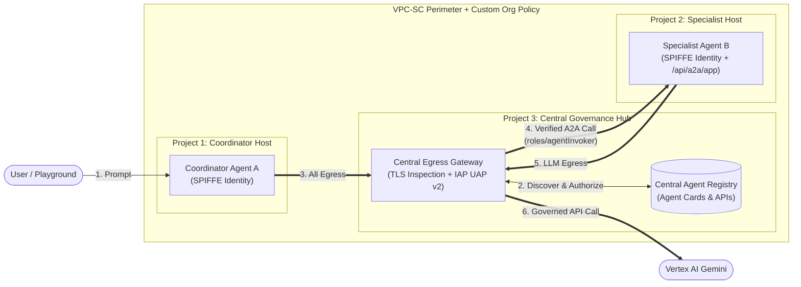

# Executive Presentation: 3-Project Enterprise A2A Governance on Google Cloud

---

## Slide 1: The Challenge & Our Zero-Trust Solution

### The Problem: Uncontrolled Multi-Project Agent Sprawl
As enterprises deploy autonomous AI agents across separate business-unit GCP projects, four critical security gaps emerge:
1. **Unrestricted Outbound Egress & Data Exfiltration**: Agents running in isolated projects can invoke unapproved external APIs, rogue MCP servers, or unauthorized LLM endpoints over encrypted HTTPS.
2. **Hardcoded Point-to-Point Sprawl**: Cross-project Agent-to-Agent (A2A) calls rely on brittle, hardcoded numeric URLs with no central inventory or governance catalog.
3. **Over-Privileged Shared Service Accounts**: Traditional IAM service accounts are shared across workloads and rely on exportable keys or broad project roles, enabling lateral movement if a single agent is compromised.
4. **Control-Plane Gateway Bypass**: Developers in spoke projects can deploy or update Vertex AI `ReasoningEngine` instances without binding them to an egress inspection gateway.

### The Solution: 3-Project Hub-and-Spoke A2A Governance
We enforce a **Zero-Trust, 100% Terraform-managed 3-Project Architecture** on Vertex AI Agent Runtime (`google-adk`):
* **Single Central Governance Hub (Project 3 — `GATEWAY_PROJECT_ID`)**:
  * **Central Egress Agent Gateway (`central-egress-gw`, `AGENT_TO_ANYWHERE`)**: Steers and TLS-inspects 100% of outbound traffic from all spoke projects.
  * **Central Agent Registry**: Serves as the single source of truth for logical A2A Agent Cards (`agents/specialist-agent-b`, `agents/coordinator-agent-a`) and allowlisted Google Cloud APIs (`essential-gcp-apis`).
  * **IAP Unified Access Policy (`V2`, `failOpen: false`)**: Evaluates every outbound request against Agent Registry bindings (`roles/iap.egressor`) before packets leave the gateway.
* **Isolated Spoke Agent Hosts (Project 1 & Project 2)**:
  * **Project 1 (`AGENT_A_PROJECT_ID`)** hosts `coordinator-agent-a`; **Project 2 (`AGENT_B_PROJECT_ID`)** hosts `specialist-agent-b`.
  * Both agents run with **SPIFFE Cryptographic Workload Identities (`AGENT_IDENTITY`)**, zero local ingress gateways, and mandatory **Control-Plane Org Policy** enforcement.

---

## Slide 2: 3-Project Architecture & End-to-End Data Flow

### Step-by-Step Governed Data Flow
1. **Inbound Request (`[0]`)**: A user or upstream service queries **Coordinator Agent A** in **Project 1** (`"Ask the specialist agent in Project B for the status of ticket TKT-101"`).
2. **Sandbox Egress Steering (`[1]`)**: Coordinator Agent A's runtime sandbox routes 100% of outbound traffic to **Project 3's `central-egress-gw`**, presenting its SPIFFE client certificate and trusting the Gateway Root CA.
3. **Identifier-Based Registry Discovery (`[2]`)**: Instead of hardcoding Project 2's URL, Agent A queries **Project 3's Central Agent Registry** for `"agents/specialist-agent-b"` and retrieves Agent B's canonical `AgentCard`.
4. **IAP UAP v2 Policy Enforcement & Cross-Project A2A (`[3]`)**: Agent A sends an A2A JSON-RPC `message/send` request to Agent B's `/api/a2a/app` endpoint. `central-egress-gw` intercepts TLS, verifies via **IAP UAP v2** (`failOpen: false`) that Agent A is authorized to egress to `specialist-agent-b`, and forwards the call to **Project 2**.
5. **SPIFFE Identity Verification & Tool Execution (`[4]`–`[5]`)**: **Project 2** verifies that the caller's Bearer token belongs to **Agent A's exact SPIFFE principal** (`roles/agentInvoker`). **Specialist Agent B** executes `get_project_b_ticket_status("TKT-101")` (routing its own Gemini LLM calls back through Project 3's `central-egress-gw`) and returns `APPROVED_IN_PROJECT_B`.

---

## Slide 3: Real-World Threat Scenarios & How the Architecture Stops Them

| # | Threat Scenario (Plain Language) | Security Control(s) Used | How Our 3-Project Structure Blocks It |
| :--- | :--- | :--- | :--- |
| **1** | **Agent A tries to call Agent B directly (bypassing the Agent Gateway)** *A developer hardcodes Agent B's direct URL in Agent A's code, or tries to deploy/update Agent A without attaching the Central Gateway so traffic skips inspection.* | **Custom Organization Policy + Sandbox Egress Steering (`central-egress-gw`)** | **1. Blocked at Deployment:** GCP's Custom Organization Policy (`custom.allowlistedEgressAgentGatewaysForAgentEngine`) rejects creating or updating any agent in Project 1 or Project 2 unless it is bound to Project 3's `central-egress-gw` (`400 CUSTOM_ORG_POLICY_VIOLATION`). **2. Forced at Runtime:** Because the gateway is attached at the Vertex AI sandbox network layer (below the container), 100% of Agent A's outbound traffic is automatically forced through `central-egress-gw` no matter what URL the Python code calls. |
| **2** | **A rogue agent or workload hosted outside Vertex AI Agent Runtime calls Agent B directly (bypassing the Agent Gateway)** *Someone spins up an unauthorized agent on Cloud Run, a VM, GKE, or a laptop inside the org and sends a direct request to Agent B's endpoint.* | **SPIFFE Workload Identity (`AGENT_IDENTITY`) + Least-Privilege IAM** | **Blocked at Agent B's Front Door:** Specialist Agent B is hosted on Vertex AI Agent Runtime and only accepts requests from Coordinator Agent A's unique, hardware-backed **SPIFFE identity** (`principal://agents.global.org-.../reasoningEngines/<AGENT_A_ID>`). Any caller running outside Agent Runtime (using a standard Service Account or user token) cannot forge or obtain this SPIFFE identity and is immediately rejected with `403 PERMISSION_DENIED` by Vertex AI before the request ever reaches Agent B's container. |
| **3** | **Prompt-injected Agent A tries to call an unapproved agent, external webhook, or rogue tool through the Gateway** *A malicious prompt tricks Agent A into trying to send data to an unapproved URL or calling an unregistered internal service.* | **Central Agent Registry Allowlist + IAP Unified Access Policy (`failOpen: false`)** | **Blocked at the Central Gateway:** Project 3's `central-egress-gw` performs **TLS inspection** (`requestWasTlsIntercepted: true`) on every outbound call and checks **IAP (`V2`, `failOpen: false`)** + the **Central Agent Registry**. If the destination URL is not explicitly registered in Project 3's Central Agent Registry, the gateway drops the request (`403 Forbidden`). |
| **4** | **Stolen credentials or an external project tries to call Agent B or exfiltrate data outside the approved projects** *An attacker outside the 3 projects—or a compromised workload trying to copy data to an external GCP project—attempts to call the agents.* | **VPC Service Controls (VPC-SC) Perimeter + `/28` PSC Interface** | **Blocked at the Perimeter Boundary:** Project 1, Project 2, and Project 3 are locked inside a single **VPC Service Controls (`VPC-SC`)** perimeter with private `/28` PSC network attachments. Any API call arriving from outside the 3-project perimeter—or attempting to reach a GCP project outside the perimeter—is blocked by Access Context Manager (`VPC_SC_VIOLATION`). |
